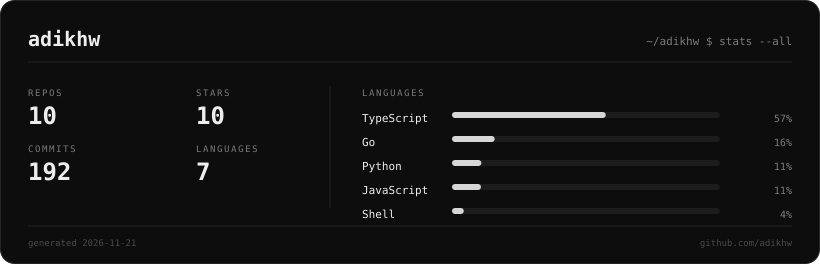

<div align="center">


<h1>kak kurta</h1>

<code>adapt or die</code>

<br /><br />

<a href="https://github.com/adikhw?tab=repositories">
  
</a>

</div>

---

### `~ whoami`

I'm **adikhw**. I learn by building the thing I'm missing, then using it every day until it's good. Most of these repos started as *"this annoys me"* — a folder I can't find, a repo I forgot to push, a reminder app that wants an account I don't have.

Fedora with GNOME bent into something keyboard-driven. Configs written down, so future me doesn't have to remember. I write the docs in Indonesian and the code in whatever the problem deserves.

### `~ now`

```console
$ cat ~/.now
building   myReminder — offline reminders, zero accounts
learning   Rust (slowly, properly)
tuning     GNOME 51 · starship graphite · JetBrainsMono NF
rule       if I don't use it daily, it's not done
```

### `~ selected work`

| kind | project | what it does | stack |
|:--:|---|---|---|
| `app` | **[myReminder](https://github.com/adikhw/myreminder)** | Reminders, tasks and class schedules that never phone home. Offline, no account, 38 tests. | TypeScript · Expo |
| `cli` | **[gscan](https://github.com/adikhw/gscan)** | Finds the repos you forgot to commit or push — in parallel, zero dependencies. | Go |
| `cli` | **[capri](https://github.com/adikhw/capri)** | Type a half-remembered folder name and land in it. Fuzzy, no `cd` chains. | Python |
| `cli` | **[yap](https://github.com/adikhw/yap)** | One command: a project skeleton with venv, git, and a README that isn't empty. | Python |

<sub>…plus a scraper → pandas pipeline, a C file organizer, a Minecraft Bedrock addon, and the dotfiles. → [all repositories](https://github.com/adikhw?tab=repositories)</sub>

### `~ stack`

<div align="center">


<sub>daily driver — Fedora 45 · GNOME 51 (Wayland) · starship · VS Code Graphite Tahoe</sub>

</div>

### `~ stats`

<div align="center">



<sub>refreshed daily by a GitHub Action — the card is an SVG this repo generates itself.</sub>

</div>

### `~ dotfiles`

Shell, prompt, VS Code and the GNOME rice live in **[dotfiles](https://github.com/adikhw/dotfiles)** — one PATH source, symlinked into `$HOME`, no drift between bash, zsh and sh.

---

```console
$ echo $MOTTO
adapt or die
```

<p align="center"><sub>README built by hand. The stats card built by a script.</sub></p>