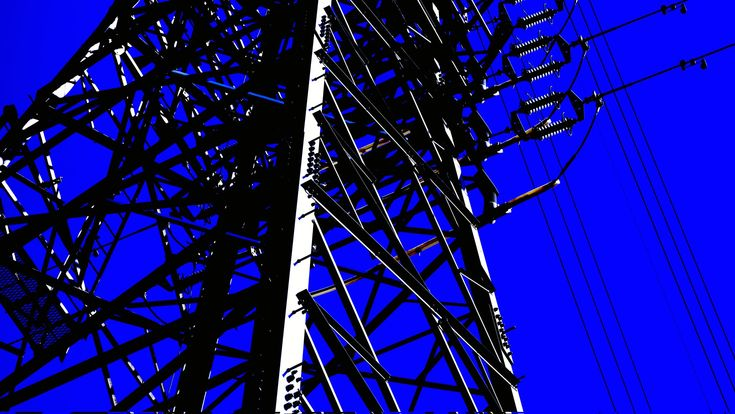

<p align="center">
  
</p>

<h1 align="center">
  
</h1>

<p align="center">
  
  
  
</p>

---

### 🖥️ `~/about`

```bash
$ fastfetch
 ┌──────────────────────────────────────────┐
  OS        ▸ Linux
  Shell     ▸ zsh / bash
  Langs     ▸ Python, Go, TypeScript
  Mode      ▸ coding for fun, no roadmap
  Status    ▸ building stuff just because
 └──────────────────────────────────────────┘
```

### ⚡ Tech Stack

<div align="center">
  
  
  
  
  
  
  
</div>

### 📊 Stats

<p align="center">
  
</p>

<p align="center">
  
</p>
